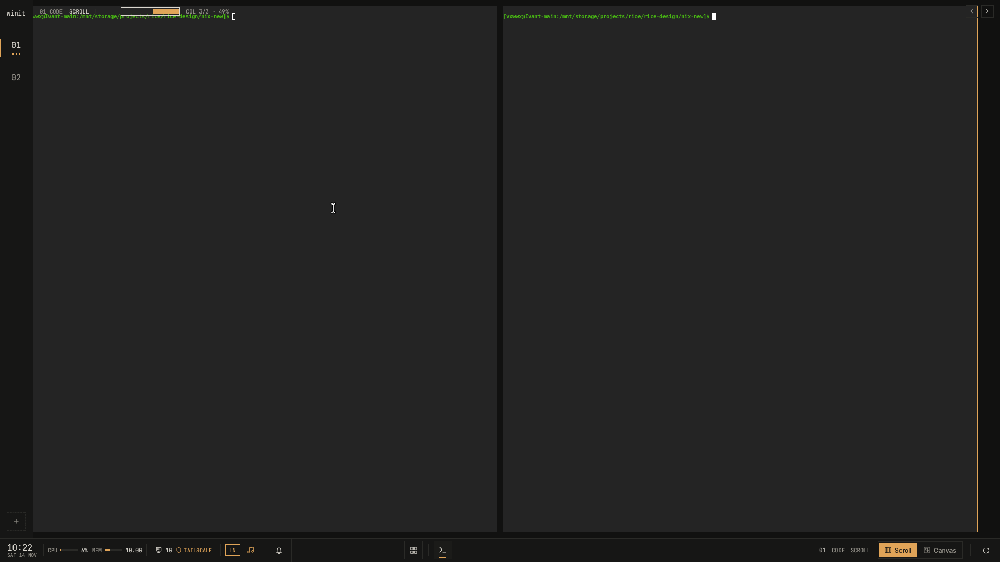
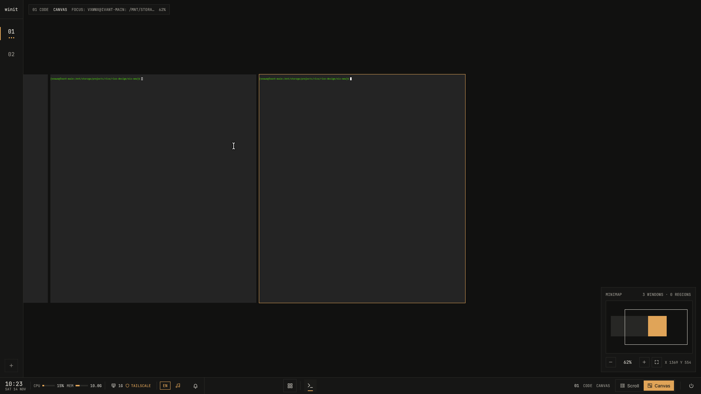
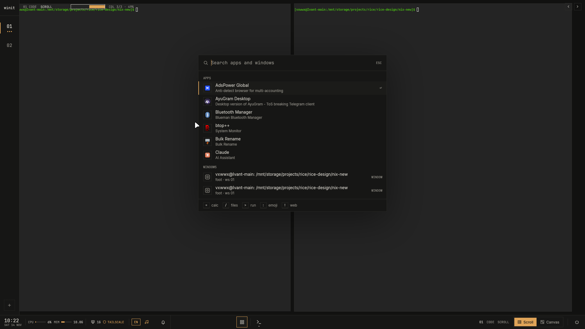
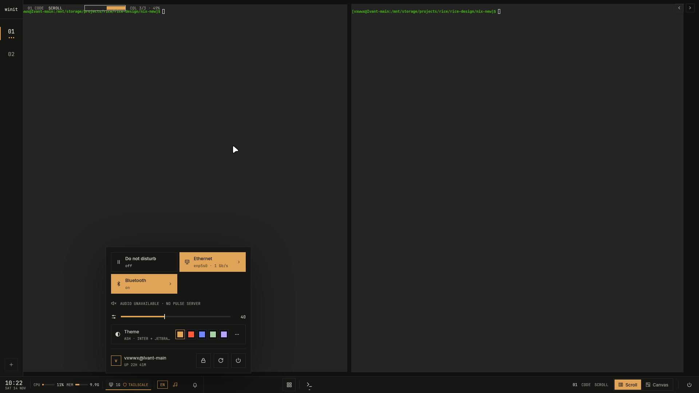
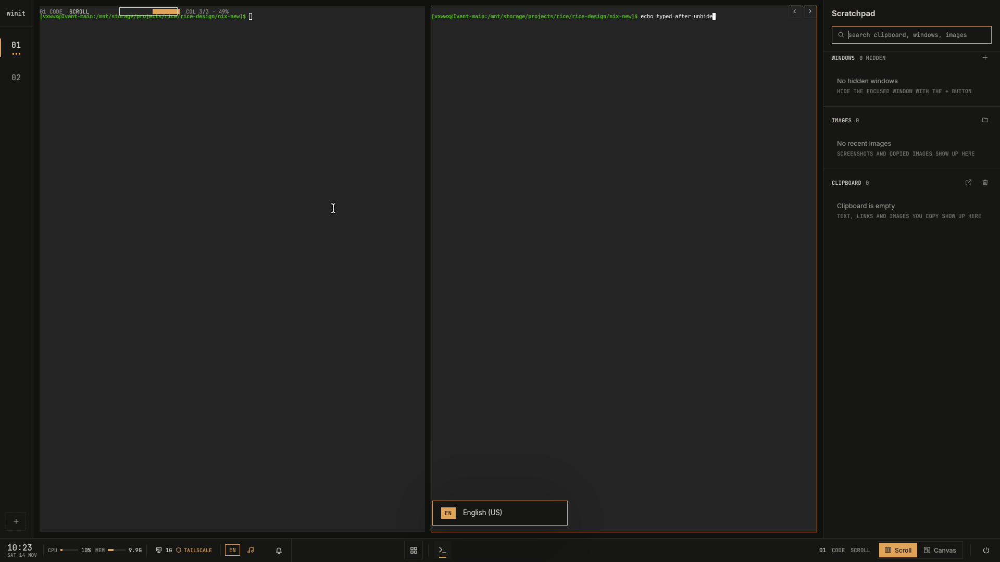
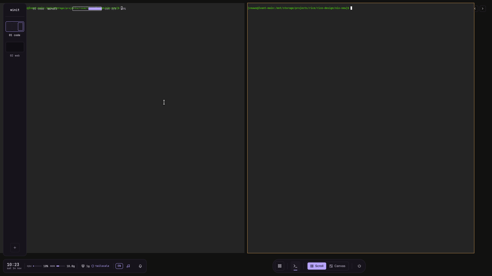

# ashd

A Linux desktop built as one piece: a fork of the [niri](https://github.com/niri-wm/niri)
compositor with a scrolling strip **and** an infinite canvas per workspace, the `ashd` shell
written in Rust on [GPUI](https://github.com/zed-industries/zed) (rail, status bar, dock,
launcher, notifications, quick settings, scratchpad, minimap, lock screen, …), and the NixOS
flake that ties them together. No scripts: every helper is the `ashd` binary.

| | |
| --- | --- |
|  |  |
|  |  |
|  |  |

The screenshots are taken in a nested test session.

- **Compositor fork:** [scarecrowgit/niri](https://github.com/scarecrowgit/niri), branch
  `ashd`; `ASHD-FORK.md` there documents what it adds.
- **Building and testing everything:** [docs/BUILD.md](docs/BUILD.md).
- **Shell internals:** [ashd/ARCHITECTURE.md](ashd/ARCHITECTURE.md),
  [docs/GPUI-NOTES.md](docs/GPUI-NOTES.md). **Keys:** [docs/KEYBINDS.md](docs/KEYBINDS.md).
- **Licence:** the `ashd/` workspace is GPL-3.0-or-later (it vendors niri's `niri-ipc`).

This is also a personal NixOS configuration: one host, `Ivant-main` (AMD GPU, Secure Boot
via lanzaboote, home-manager as a NixOS module). Take `modules/desktop` and `ashd/`; the
host and app list are specific to that machine.

## Layout

```text
flake.nix  flake.lock
hosts/Ivant-main/     the machine: default, boot, storage, hardware-configuration,
                      vars (plain data), packages, desktop (sets the ashd.* options)
modules/base/         shared system settings: nix, locale, boot, fonts, zsh, starship,
                      tmux, gh, docker/, openvpn/
modules/apps/         kitty, yazi, fm, flclashx, claude-desktop, browsers, neovim/
modules/desktop/      the ashd desktop; default.nix declares the ashd.* options
  niri.nix            /etc/niri/config.kdl, assembled from niri/*.nix (Nix data -> KDL)
  niri/               layout, animations, workspaces (hidden scratchpad), input, rules, binds
  shell.nix           ashd-shell user service, /etc/ashd/{theme,shell.json,keybinds.json},
                      theme-apply activation hook, polkit agent choice
  session.nix         greetd + ashd-greeter (or tuigreet), session entry
  portals.nix audio.nix env.nix theme.nix lock.nix power.nix
packages/             adspower, octo-browser, dolphin-anty, flclashx, learnharness,
                      multica, fm (GPUI file manager), ashd (Cargo workspace in ./ashd)
overlays/             discord.nix, ashd.nix (adds pkgs.ashd and pkgs.fm)
ashd/                 the shell's Cargo workspace (ARCHITECTURE.md is the contract)
tests/vm.nix          VM test: greetd login, niri, ashd-shell, `ashd ping`
docs/BUILD.md         how to build, test and install
docs/KEYBINDS.md      keybind table (source: modules/desktop/niri/binds.nix)
docs/screenshots/     the pictures above
```

## Inputs worth knowing

- `niri`: the fork, [scarecrowgit/niri](https://github.com/scarecrowgit/niri), branch `ashd`.
  After pushing there run `nix flake update niri` and commit the new `flake.lock`.
  `ASHD-FORK.md` in that repo documents every option and action the config uses.
- `fm-src`: the file manager, [scarecrowgit/fm](https://github.com/scarecrowgit/fm)
  (`flake = false`), built by `packages/fm`.
- `crane`: builds the `ashd` workspace.

## Check, build, switch, roll back

```sh
nix flake check --no-build                         # evaluates everything, incl. the keybind assertions
nix build .#niri                                   # the compositor fork
nix build .#ashd                                   # ashd, ashd-shell, ashd-lock (crane)
nix build .#fm                                     # file manager
nix build .#checks.x86_64-linux.vm                 # VM test (needs KVM)

sudo nixos-rebuild build  --flake .#Ivant-main     # build only, nothing activates
sudo nixos-rebuild switch --flake .#Ivant-main     # activate now (the `rebuild` zsh alias)
sudo nixos-rebuild boot   --flake .#Ivant-main     # activate on next boot

sudo nixos-rebuild switch --rollback               # back to the previous generation
nixos-rebuild list-generations                     # or pick one in the boot menu
nix develop                                        # dev shell from ashd/shell.nix
```

Details, the dev loop and the test harness: [docs/BUILD.md](docs/BUILD.md).

The generated niri config can be checked without a session. Write it out and validate it
with the fork's binary (a file validation, not a compositor start):

```sh
nix eval --raw '.#nixosConfigurations.Ivant-main.config.environment.etc."niri/config.kdl".text' > /tmp/config.kdl
$(nix build .#niri --no-link --print-out-paths)/bin/niri validate -c /tmp/config.kdl
```

## Theme and keybinds

- **Theme.** `ashd.theme` (ash, ink, midnight, moss, dusk) is the configured default and
  lands in `/etc/ashd/theme`. `ashd theme set|cycle|pick|apply` switches at runtime and
  writes `~/.local/state/ashd/generated/` (`kitty.conf`, `starship-palette.toml`,
  `nvim.lua`, `gtk.css`, `niri.kdl`; contract in `ashd/ARCHITECTURE.md` section 8).
  `home-manager` runs `ashd theme apply --quiet` on activation.
- **niri config.** `/etc/niri/config.kdl` carries the Ash values for everything the fork
  adds: title strips, focus ring with gap, canvas grid and regions, zoom steps, canvas
  animations, the hidden `scratch` workspace, window rules. The last line includes the
  generated `niri.kdl`, which restates the theme-dependent keys (colours, gaps, fonts,
  grid style, corner radius, default workspace mode, top strut, and for the floating themes the
  work-area outline and clip).
  Both are parsed into one config and merge per key; the comment at the top of
  `modules/desktop/niri/layout.nix` lists the exceptions (`struts` on equal sides, sticky `off`,
  accumulating window rules). `niri.service` gets `NIRI_CONFIG`, so a leftover
  `~/.config/niri` is ignored.
- **Keybinds.** Nix data in `modules/desktop/niri/binds.nix`, rendered to the `binds`
  block, to `/etc/ashd/keybinds.json` (the `Super+/` cheatsheet) and mirrored by hand in
  `docs/KEYBINDS.md`. A build assertion rejects a key combination bound twice.
- **Options worth knowing** (`modules/desktop/default.nix`): `ashd.apps.*`, `ashd.dock.pinned`,
  `ashd.outputs`, `ashd.layout.topStrut`, `ashd.scratchpad.{enable,name}`,
  `ashd.windowRules.noTitleBar` (app-id regexes that get no compositor title strip).

## Fallbacks

| Option | Default | Fallback |
| --- | --- | --- |
| `ashd.shell.enable` | `false` (Ivant-main sets `true`) | `false`: no `ashd-shell` service, no shell binds (the ones with a niri equivalent keep it), no `/etc/ashd/keybinds.json`; niri and the static config still work |
| `ashd.polkitAgent` | `soteria` | `ashd` selects the shell's built-in agent (needs the shell) |
| `ashd.greeter.kind` | `tuigreet` | `ashd` opts into the graphical ashd-greeter; never seen working end to end yet (the VM test cannot show it), so enable it after a first successful login and keep Ctrl+Alt+F2 in mind |
| `ashd.scratchpad.enable` | `true` | `false`: no hidden workspace (Super+N is `focus-workspace N` either way, the fork skips hidden workspaces when counting) |
| `ashd.fm.enable` | `true` | `false` if `packages/fm` does not build |

## New host / hardware config

```sh
ashd sys generate-hardware-config <host>
```

writes `hosts/<host>/hardware-configuration.nix` (wraps `nixos-generate-config
--show-hardware-config`).
